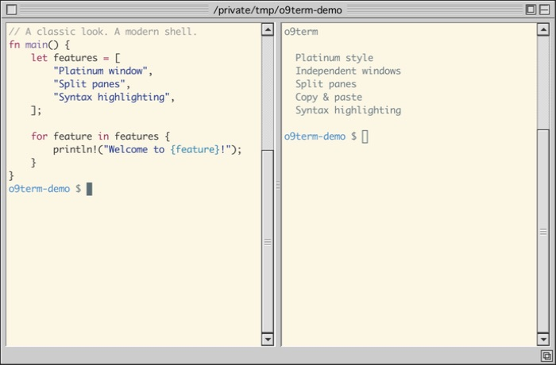

# o9term

Mac OS 9 (Platinum) 風の見た目を持つ、Rust製ターミナルエミュレータ。macOS専用。




公開用サンプルを表示した実際のアプリ画面。

## 特徴

- OS標準のウィンドウ装飾を使わず、タイトルバー（横縞・クローズ/ズーム/カラプスボックス・グローボックス）をピクセル単位で自前描画
- 本物のターミナル: PTY経由でログインシェル（zsh等）を起動し、VT100/ANSIエスケープを解釈
- クラシックMacらしい白地に黒文字 + Monacoフォント
- Cmd+Nで独立したウィンドウを追加。同じアプリで動作し、Dockのアイコンは1つ
- ウィンドウごとに上下左右へペイン分割。ペインごとに独立したPTY
- スプリッターはタイトルバーと同じリブ（横縞）の意匠。ドラッグで分割比を変更
- 非アクティブペインはクラシックMacの流儀で「中抜きカーソル」表示
- 日本語IMEの変換中表示・文節選択・確定入力。候補位置はフォーカス中のペインに追従
- ペインごとのOS9風スクロールバー、ウィンドウシェード、ビジュアルベル

## アーキテクチャ

| 層 | 実装 |
|---|---|
| 端末エミュレーション・PTY | [`alacritty_terminal`](https://crates.io/crates/alacritty_terminal) |
| ウィンドウ・入力 | [`winit`](https://crates.io/crates/winit) |
| 描画 | [`softbuffer`](https://crates.io/crates/softbuffer)（CPU描画） |
| フォント | [`core-text`](https://crates.io/crates/core-text) + macOS内蔵 Monaco / Geneva。無い文字はCoreTextが別のフォントから探す |

```
src/
├── main.rs      … winitイベントループ、複数ウィンドウの作成・イベント振り分け
├── terminal_window.rs … 各ウィンドウのペイン・入力・描画・設定ウィンドウ
├── instance.rs  … macOSの起動・フォルダを開くイベントの受け取り
├── panes.rs     … ペイン二分木（分割・移動・削除・レイアウト計算）
├── term.rs      … PTYとalacritty_terminalの起動・接続
├── renderer.rs  … Platinumクローム + グリッドのCPUレンダラ
├── font.rs      … CoreTextでグリフを濃さの表にする。ブロック要素はマスいっぱいに描く
├── render_snapshot.rs … 描画を変えない変更を確かめるテスト（docs/development.md）
├── theme.rs     … Platinum配色・ANSIパレット・カラースキーマ定義
├── config.rs    … 配色・文字描画設定の保存・読み込み
├── clipboard.rs … 選択文字列のコピー・貼り付け
├── ime.rs       … 日本語IMEの変換状態・表示位置
└── window_shade.rs … ウィンドウシェードの保存・復元
```

カラースキーマは クラシック（白地）/ ダーク / Solarized ダーク / Solarized ライト / グリーンCRT の5種。Cmd+, で開くOS9コントロールパネル風の設定ウィンドウから選択でき、全ウィンドウへ即時反映・自動保存される。

同じ設定ウィンドウで「ビットマップ風の文字」をオンにすると、文字のアンチエイリアスを無効にできる。

## インストール

配布パッケージ（ZIP）を展開し、中の `install.command` を一度だけ実行します。Rust・Python・Homebrew・ネットワークは不要です。

```sh
open o9term-0.1.0-macos-arm64/install.command
```

インストーラーは次のものを置きます。

| 置く場所 | 内容 |
|---|---|
| `~/Applications/o9term.app` | アプリ本体 |
| `~/.local/bin/o9` | 起動コマンド |
| `~/.config/os9terminal/integration.zsh` | 構文ハイライトなどのzsh連携 |
| `~/.zshrc` | zsh連携を読み込む1行（`# o9term` の下） |
| `~/.zprofile` | `~/.local/bin` をPATHに足す1行（`# o9term command` の下） |

`~/.zshrc` と `~/.zprofile` は、初めて書き換える前に `*.os9terminal-backup` としてバックアップします。インストール後は新しいターミナルを開いて `o9` を実行してください。

配布パッケージはソースから作ります。手順は[開発ガイド](docs/development.md)の「Build a release package (maintainers only)」を参照してください。

### 更新する

更新も同じ `install.command` を実行します。それまでのアプリは `~/Applications/o9term.app.previous` として残ります。

`o9term.app.previous` がすでにあると、インストーラーは止まります。その場合は先に `o9term.app.previous` をゴミ箱へ移してから実行してください。

起動中の o9term は古い版のまま動き続けます。Cmd+Q で終了してから開き直すと、新しい版になります。

## アンインストール

1. Cmd+Q で o9term を終了します。
2. アプリ・起動コマンド・設定をゴミ箱へ移します。

   ```sh
   mv ~/Applications/o9term.app ~/Applications/o9term.app.previous ~/.local/bin/o9 ~/.config/os9terminal ~/.Trash/
   ```

   `~/.config/os9terminal` にはzsh連携と、設定ウィンドウで選んだ配色などの `config.toml` が入っています。`o9term.app.previous` が無い場合は、その分だけ「No such file or directory」と表示されます。ほかのものはゴミ箱へ移ります。
3. `~/.zshrc` から、`# o9term` とその次の行を消します。
4. `~/.zprofile` から、`# o9term command` とその次の行を消します。ほかのツールのために `~/.local/bin` をPATHに入れている場合は、次の行は残してください。

## 起動

インストール後は、任意のディレクトリから:

```sh
o9
```

そのディレクトリで新しいウィンドウを開きます。`o9 /path/to/project` でディレクトリの指定もできます。起動済みなら同じアプリへウィンドウを追加するため、Dockのアイコンは増えません。入力・コード表示の構文ハイライトも設定済みです。
開発については[開発ガイド](docs/development.md)を参照してください。

## 操作

- タイトルバーをドラッグ → ウィンドウ移動
- 左のクローズボックス → そのウィンドウを閉じる
- 右下のグローボックス → リサイズ
- 端末内ドラッグ → テキスト選択（ダブルクリックで単語、トリプルクリックで行）
- Cmd+C → 選択文字列をコピー、Cmd+V → フォーカス中ペインへ貼り付け
- マウスホイール → スクロールバック（カーソル直下のペイン）
- スクロールバー → 矢印で1行、溝のクリックで1ページ、つまみのドラッグで履歴を移動（矢印・溝は長押し対応）
- タイトルバー右端のカラプスボックス → タイトルバーだけに畳む／元のサイズへ戻す。シェルは動作を継続
- スプリッターをドラッグ → 分割比の変更
- Cmdを押しながらペイン内をドラッグ → 同じウィンドウ内の別ペインの上下左右へ移動（Escapeでドラッグを中止）

日本語入力はmacOSの入力ソースを切り替えて使用する。変換中の文字には下線が付き、確定した文字だけがシェルへ送られる。ペイン切替やウィンドウのフォーカス移動で未確定の変換は解除される。

| 操作 | ショートカット |
|---|---|
| 新規ウィンドウ（フォーカス中ペインのディレクトリを引き継ぐ） | Cmd+N |
| 操作中のウィンドウを閉じる | Cmd+W |
| 矢印の方向に新しいペインを追加 | Cmd+Control+矢印 |
| 右に分割 / 下に分割（従来のショートカット） | Cmd+D / Cmd+Shift+D |
| ペイン間フォーカス移動 | Cmd+Option+矢印 |
| ペインを閉じる | シェルのexit、または Cmd+Shift+W |
| 設定（カラースキーマ・文字描画） | Cmd+,（Escapeまたはクローズボックスで閉じる） |
| アプリ全体を終了 | Cmd+Q |

分割はショートカットで操作する。操作中のペインを二分し、指定方向に新しいペインを配置してフォーカスする。新しいペインは元のペインのディレクトリを引き継ぐ。

Cmd+Wはそのウィンドウ内のすべてのペインを閉じる。最後のペインを閉じるか、最後のシェルが終了した場合も、そのウィンドウだけが閉じる。他のウィンドウは動作を続け、すべて閉じるとアプリが終了する。

## 対応状況

- [x] 複数ウィンドウ（Cmd+N・Dockアイコンは1つ）
- [x] Cmd+C / Cmd+V のクリップボード対応
- [x] テキスト選択
- [x] 日本語IMEの変換中表示・確定入力・候補位置
- [x] 上下左右へのペイン分割・ウィンドウ内でのドラッグ移動
- [x] OS9風スクロールバー
- [x] カラプスボックスでのウィンドウシェード
- [x] ベルのビジュアルフラッシュ
- [x] ビットマップ風レンダリング（アンチエイリアス無効）オプション
