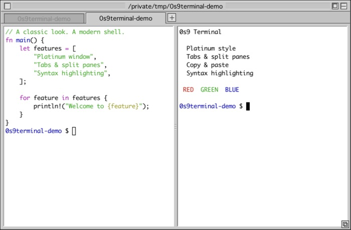

# 0s9terminal

Mac OS 9 (Platinum) 風の見た目を持つ、Rust製ターミナルエミュレータ。macOS専用。




公開用サンプルを表示した実際のアプリ画面。

## 特徴

- OS標準のウィンドウ装飾を使わず、タイトルバー（横縞・クローズ/ズーム/カラプスボックス・グローボックス）をピクセル単位で自前描画
- 本物のターミナル: PTY経由でログインシェル（zsh等）を起動し、VT100/ANSIエスケープを解釈
- クラシックMacらしい白地に黒文字 + Monacoフォント
- タブ（Platinumタブコントロール風・角形）とペイン分割。ペインごとに独立したPTY
- スプリッターはタイトルバーと同じリブ（横縞）の意匠。ドラッグで分割比を変更
- 非アクティブペインはクラシックMacの流儀で「中抜きカーソル」表示

## アーキテクチャ

| 層 | 実装 |
|---|---|
| 端末エミュレーション・PTY | [`alacritty_terminal`](https://crates.io/crates/alacritty_terminal) |
| ウィンドウ・入力 | [`winit`](https://crates.io/crates/winit) |
| 描画 | [`softbuffer`](https://crates.io/crates/softbuffer)（CPU描画） |
| フォント | [`fontdue`](https://crates.io/crates/fontdue) + macOS内蔵 Monaco / Geneva |

```
src/
├── main.rs      … winitイベントループ、キー/マウス入力、設定ウィンドウ
├── tabs.rs      … タブとペイン二分木（分割・削除・レイアウト計算）
├── term.rs      … PTYとalacritty_terminalの起動・接続
├── renderer.rs  … Platinumクローム + タブバー + グリッドのCPUレンダラ
├── theme.rs     … Platinum配色・ANSIパレット・カラースキーマ定義
└── config.rs    … 設定の永続化（~/.config/os9terminal/config.toml）
```

カラースキーマは クラシック（白地）/ ダーク / Solarized ダーク / Solarized ライト / グリーンCRT の5種。Cmd+, で開くOS9コントロールパネル風の設定ウィンドウから選択でき、即時反映・自動保存される。

## ビルド・実行

```sh
cargo run
```

## 操作

- タイトルバーをドラッグ → ウィンドウ移動
- 左のクローズボックス → 終了（Cmd+Q でも可）
- 右下のグローボックス → リサイズ
- 端末内ドラッグ → テキスト選択（ダブルクリックで単語、トリプルクリックで行）
- Cmd+C → 選択文字列をコピー、Cmd+V → フォーカス中ペインへ貼り付け
- マウスホイール → スクロールバック（カーソル直下のペイン）
- スプリッターをドラッグ → 分割比の変更
- タブをペインの上下左右の辺付近へドラッグ → そこにドッキング（タブの中身ごとペインとして合流）
- タブをタブバー内でドラッグ → 並べ替え

| 操作 | ショートカット |
|---|---|
| 新規タブ / タブを閉じる | Cmd+T / Cmd+W |
| タブ切替 | Cmd+1〜9、Cmd+Shift+[ ] |
| 左右分割 / 上下分割 | Cmd+D / Cmd+Shift+D |
| ペイン間フォーカス移動 | Cmd+Option+矢印 |
| ペインを閉じる | シェルのexit、または Cmd+Shift+W |
| 設定（カラースキーマ） | Cmd+,（Escapeまたはクローズボックスで閉じる） |

タブバーはタブが2枚以上のときだけ表示される（1枚なら従来の見た目のまま）。

## 今後の予定

- [x] Cmd+C / Cmd+V のクリップボード対応
- [x] テキスト選択
- [ ] OS9風スクロールバー
- [ ] カラプスボックスでのウィンドウシェード（現在は最小化）
- [ ] ベルのビジュアルフラッシュ
- [ ] ビットマップ風レンダリング（アンチエイリアス無効）オプション

## Syntax highlight

Homebrew導入済みのmacOSで、初回に実行:

```sh
python3 scripts/setup-highlighting.py
```

batとzsh-syntax-highlightingをインストールし、連携スクリプトを
~/.config/os9terminal/integration.zshへ配置、.zshrcの末尾に読み込みを追加する。
既存.zshrcは初回変更時に.zshrc.os9terminal-backupへ保存する。
ZDOTDIRを使う場合は同じ環境変数を指定して実行する。

新しいタブを開くと、zshの入力中のコマンド・文字列などが色分けされる。
ファイルは `bat src/main.rs`、ページ送りなしなら
`bat --paging=never src/main.rs` で表示する。
batのANSIテーマを既定にし、端末の配色に追従する（既存BAT_THEME設定は優先）。
この連携は0s9terminalの対話zsh内でのみ有効。
catや他のコマンドの出力は自動で構文解析しない。

解除する場合は.zshrc末尾の0s9terminal読み込み行を削除する。

参照: [zsh-syntax-highlighting](https://github.com/zsh-users/zsh-syntax-highlighting/blob/master/INSTALL.md)、
[bat](https://github.com/sharkdp/bat)。
